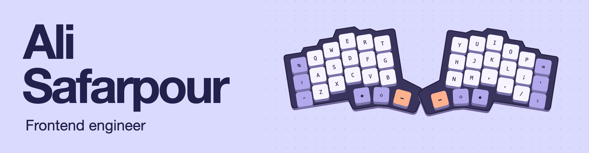

# 

I came to frontend engineering from civil engineering. I like interfaces I can navigate entirely by keyboard, and I spend a lot of time thinking about where state belongs.

## My stack

 

<strong>Tools and current interests</strong>

- **Interfaces** — Next.js, Tailwind CSS, TanStack, and Zustand
- **Graphics and maps** — Three.js, React Three Fiber, Blender, and MapLibre
- **Browser APIs** — Web Workers, service workers, WebSockets, and extensions
- **Testing** — Vitest and Playwright
- **Currently exploring** — WebGPU, GLSL, Go, Swift, and browser internals

## Beat the keeper

My undefeated foosball record is fiercely disputed. Here’s your shot. The rods are frozen. Trace a path to the goal on the right, then open your pick.

A · Aim for the high post

Blocked. The far corner is open, but the defender gets a foot to the diagonal. Try another shot.

B · Bank off the rail

**Goal!** The rebound slips behind the defender and above the keeper. There goes my record.

C · Shoot straight

Saved. You beat the defender, but the keeper is waiting on the ball’s line. Try another shot.

[Email me](mailto:alisafarpour.1997@gmail.com) · [LinkedIn](https://linkedin.com/in/ali-safarpour-dev)
