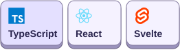

# 

I came to frontend engineering from civil engineering. I like interfaces I can navigate entirely by keyboard, and I spend a lot of time thinking about where state belongs.

## My stack

 

<strong>Tools and current interests</strong>

- **Interfaces** — Next.js, Tailwind CSS, TanStack, and Zustand
- **Graphics and maps** — Three.js, React Three Fiber, Blender, and MapLibre
- **Browser APIs** — Web Workers, service workers, WebSockets, and extensions
- **Testing** — Vitest and Playwright
- **Currently exploring** — WebGPU, GLSL, Go, Swift, and browser internals

Away from the keyboard, I’m usually up for a game of foosball. My undefeated record is fiercely disputed.

[Email me](mailto:alisafarpour.1997@gmail.com) · [LinkedIn](https://linkedin.com/in/ali-safarpour-dev)
